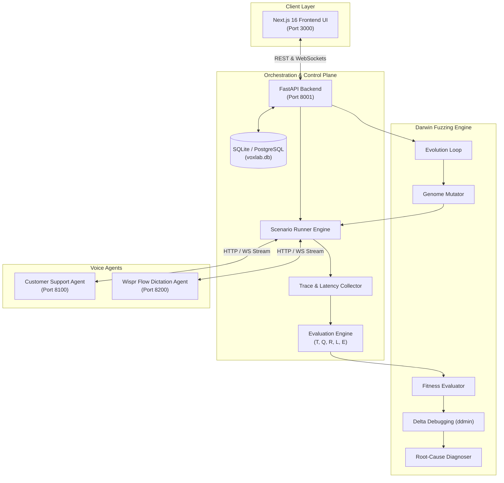

# VoxLab — Voice AI Reliability & Evolutionary Crash-Test Platform

[](LICENSE)
[](https://www.python.org/)
[](https://fastapi.tiangolo.com)
[](https://nextjs.org)
[](backend/tests/)
[](https://wisprflow.ai)

**VoxLab** is an automated reliability infrastructure, evolutionary adversarial fuzzing platform (**"Darwin"**), and CI crash-test dummy designed for conversational voice AI agents and real-time speech-to-text dictation pipelines (such as Wispr Flow).

Instead of relying on fragile manual testing, VoxLab automatically generates adversarial voice personas, mutates conversation turns, detects subtle intent failures, delta-debugs failures down to minimal 1-turn reproductions, and exports permanent regression tests directly into your CI pipeline.

---

## ⚡ Key Capabilities

- **🧬 Darwin Evolutionary Fuzzing Engine:** Genetic testing engine exploring combinatorial spaces of conversational disruptions across generations.
- **🎯 Wispr Flow Attack Personas:**
  - *Self-Corrector:* Mid-sentence intent reversals (*"Tuesday, wait no, Wednesday at 4"*).
  - *Homophone Confuser:* Phonetically ambiguous terms (*"two"* vs *"to"*, *"accept"* vs *"except"*).
  - *Filler-Heavy Rambler:* Speech disfluency suppression without dropping valid words (*"um, actually"*).
  - *Barge-In Interrupter:* Asynchronous interruptions and state rollback.
  - *Context Switcher:* Domain shifts testing slot retention and memory.
- **🔍 Delta Debugging (`ddmin`):** Automatically reduces multi-turn conversation failures down to the minimal 1-turn reproducible defect sequence.
- **🩺 AI Root-Cause Diagnostic & Auto-Doctor:** Evaluates execution traces to classify defect taxonomy and propose verified system prompt patches.
- **📦 1-Click CI Regression Suite Export:** Exports discovered bugs into standardized JSON test scenarios for automated GitHub Actions PR gates.
- **📊 Real-Time Observability & Tracing:** Turn-level STT, LLM, tool-call, and TTS latency breakdowns with interactive waterfall timelines.

---

## 🏗️ System Architecture



---

## 🚀 Quick Start (Local Setup)

### Prerequisites
- **Python 3.11+**
- **Node.js 18+ or 20+**

### 1. Backend Server (Port 8001)
```bash
cd backend
python -m venv .venv

# Windows:
.venv\Scripts\activate
# Linux / macOS:
source .venv/bin/activate

pip install -r requirements.txt
python -m uvicorn app.main:app --port 8001 --reload
```
Interactive API documentation: `http://localhost:8001/docs`.

### 2. Standalone Demo Voice Agents
Open two separate terminals:

```bash
# Terminal 2: Customer Support Agent (Port 8100)
cd agent-examples/customer-support-agent
python -m uvicorn main:app --port 8100

# Terminal 3: Wispr Flow Dictation Agent (Port 8200)
cd agent-examples/dictation-agent
python -m uvicorn main:app --port 8200
```

### 3. Frontend Web Application (Port 3000)
```bash
# Terminal 4: Next.js Frontend
cd frontend
npm install
npm run dev
```

### 4. One-Click Demo Access
1. Open [http://localhost:3000](http://localhost:3000) in your browser.
2. Click **"Explore with Demo Account"** (or use `demo@voxlab.dev` / `demo1234`).
3. Both demo agents are pre-registered and ready for testing.

---

## 🧪 Testing & Verification

Run the full automated test suite:

```bash
# Backend Pytest Suite (109 tests)
cd backend
pytest -v

# Frontend Production Build Compilation
cd frontend
npm run build
```

---

## 🐳 Docker Multi-Container Deployment

To boot the entire stack in isolated Docker containers:

```bash
docker-compose up --build
```

---

## 📚 Technical Documentation

Comprehensive architectural and engineering documentation is available in `docs/`:

- [PRD & Product Scope](docs/PRD.md)
- [System Architecture](docs/architecture.md)
- [System Design & Component Lifecycle](docs/SYSTEM_DESIGN.md)
- [Darwin Evolutionary Engine Guide](docs/darwin/DARWIN_OVERVIEW.md)
- [Delta Debugging (ddmin) Minimization](docs/darwin/FAILURE_MINIMIZATION.md)
- [Threat Model & Security Controls](docs/security/THREAT_MODEL.md)
- [Testing Strategy & Coverage Report](docs/TESTING_STRATEGY.md)
- [Release Readiness Checklist](REPOSITORY_RELEASE_CHECKLIST.md)

---

## 🤝 Contributing

We welcome contributions! Please review our [Contributing Guidelines](CONTRIBUTING.md) and [Code of Conduct](CODE_OF_CONDUCT.md).

---

## 🔒 Security & Vulnerability Reporting

Please report vulnerabilities privately according to our [Security Policy](SECURITY.md).

---

## 📄 License

VoxLab is open-source software licensed under the [MIT License](LICENSE).
