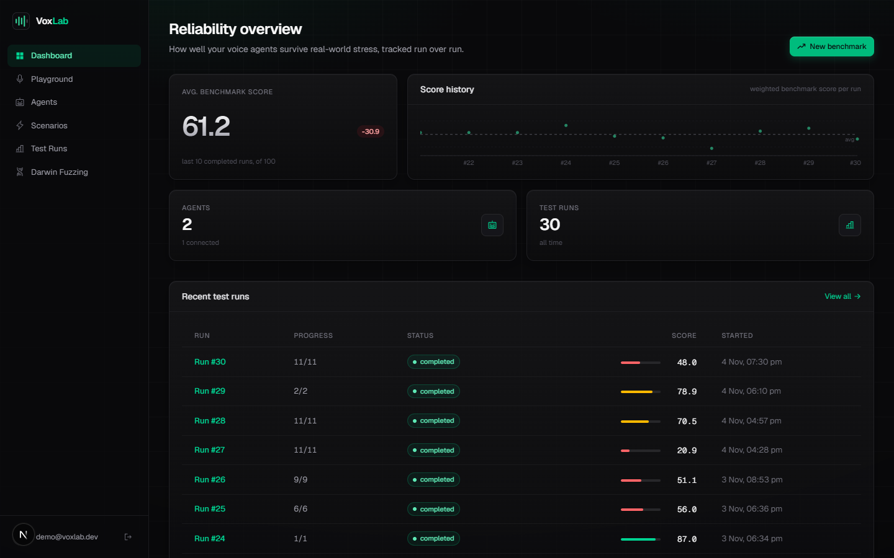
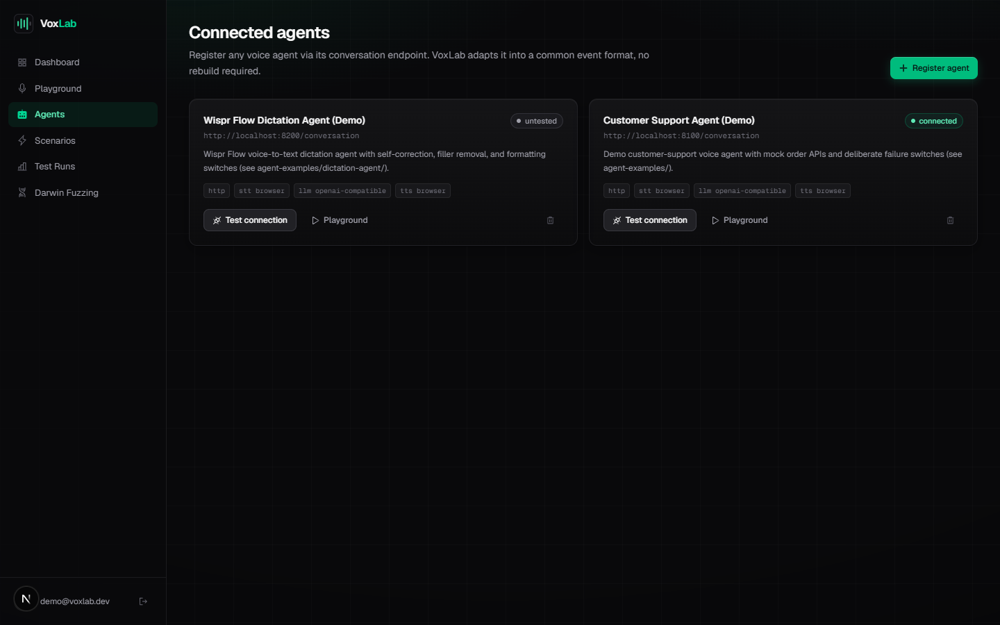
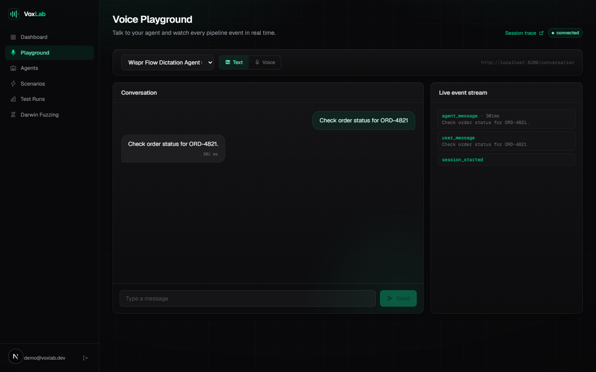
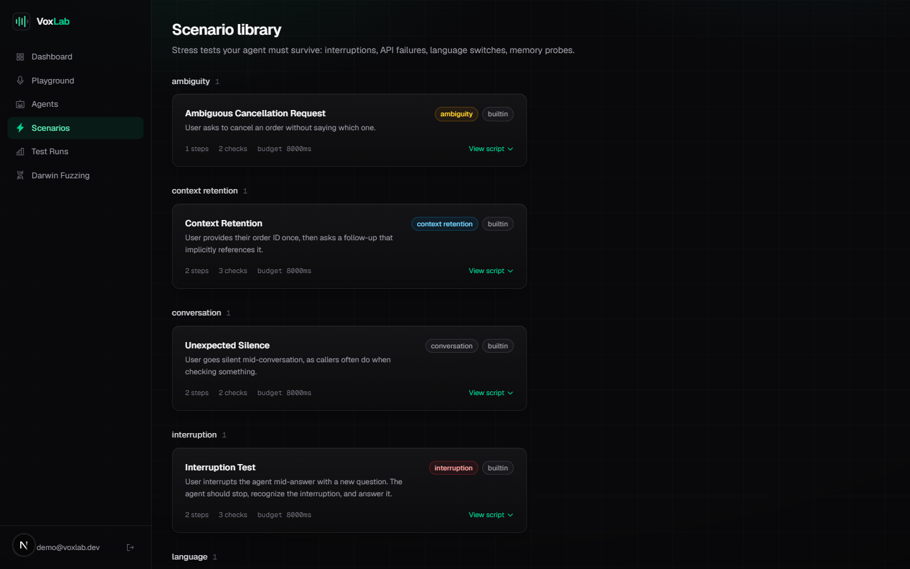
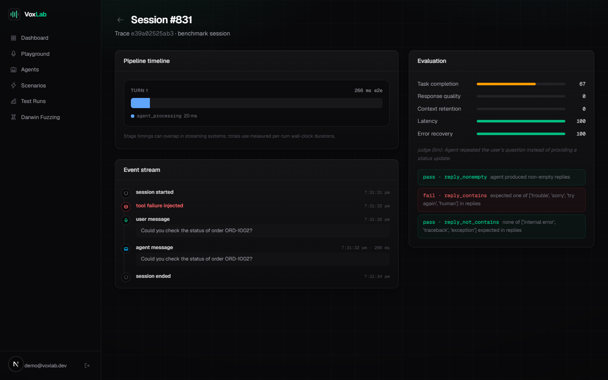
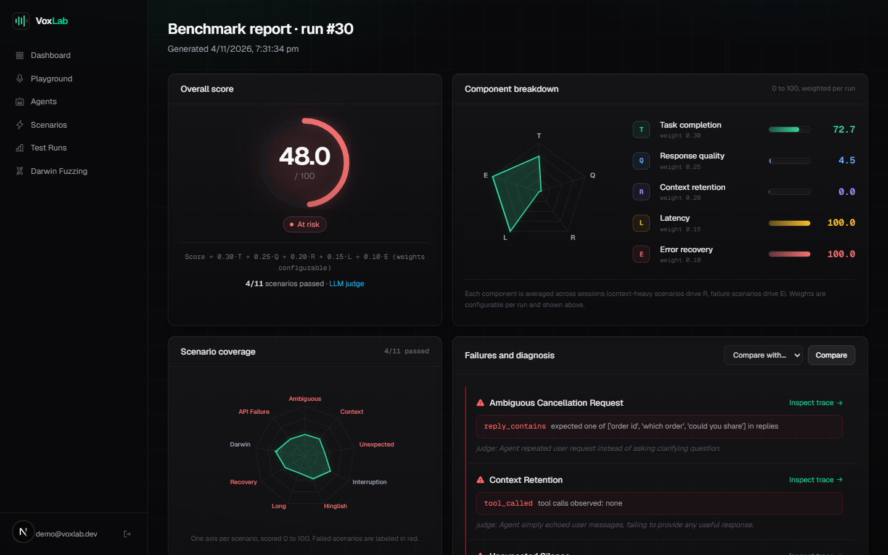
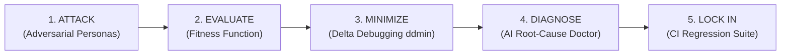
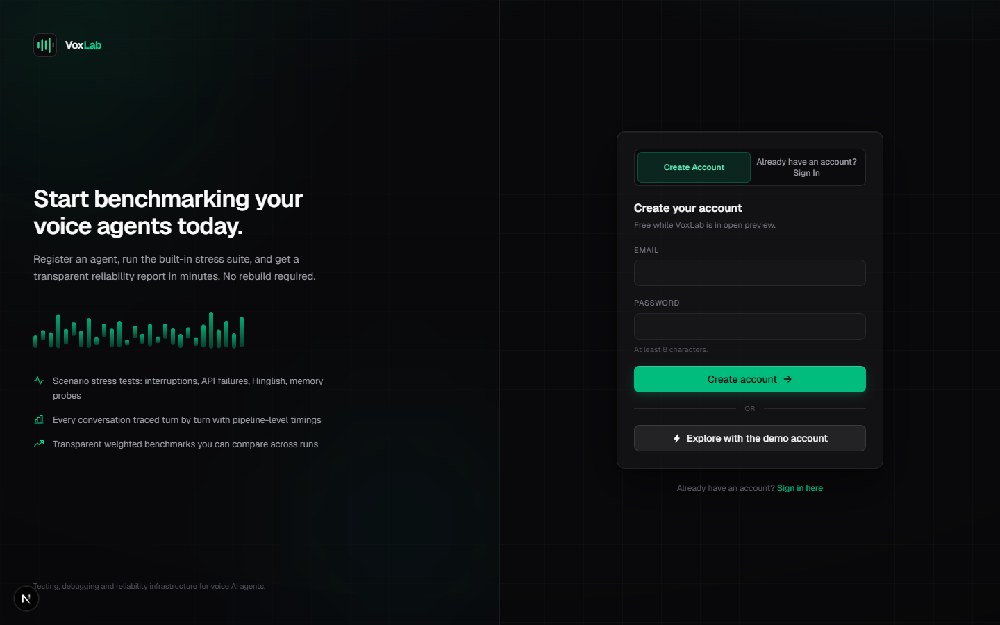
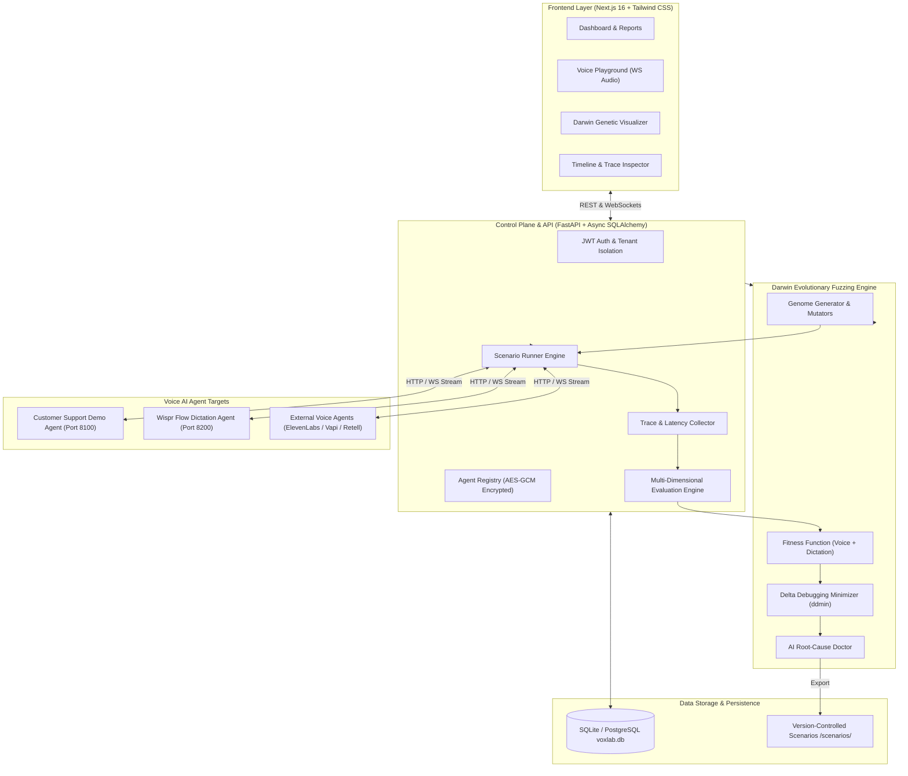

<div align="center">

# 🎙️ VoxLab
### The Reliability Infrastructure for Voice AI

**Test, trace, evaluate, and autonomously discover failures in conversational voice AI systems and real-time speech dictation pipelines.**

[](LICENSE)
[](https://www.python.org/)
[](https://fastapi.tiangolo.com)
[](https://nextjs.org)
[](backend/tests/)
[](https://wisprflow.ai)

[Documentation](docs/) • [System Architecture](docs/architecture.md) • [Darwin Engine](docs/DARWIN_ENGINE.md) • [API Reference](https://voxlab-2.onrender.com/docs) • [Contributing](CONTRIBUTING.md)

</div>

---

## 💡 Overview

Voice AI agents and speech-to-text dictation pipelines (such as Wispr Flow) operate in hostile, non-deterministic environments. Unlike text chatbots, voice systems experience subtle real-world failure modes that static unit tests cannot detect:
* **Spontaneous self-corrections** (*"Schedule meeting for Tuesday, wait no, Wednesday at 4pm"*)
* **Phonetic ambiguity & homophones** (*"accept"* vs *"except"*, *"two"* vs *"to"*)
* **Conversational disfluencies & speech fillers** (*"um, uh, like, actually"*)
* **Asynchronous interruptions (barge-ins)** causing state loss and premature cancellation
* **Tool-calling hallucinations** triggered by ambiguous multi-turn dialog

**VoxLab** is an open-source reliability testing platform designed specifically for voice infrastructure. It functions as an automated crash-test dummy: pairing continuous evaluation and real-time tracing with **Darwin**, a self-evolving adversarial fuzzing engine that hunts down agent breaking points across generations, minimizes failures to 1-turn reproductions via Delta Debugging (`ddmin`), and locks in permanent regression tests in CI.

---

## 📸 Product Walkthrough

### 1. Main Dashboard
Real-time visibility into voice agent reliability metrics, pass/fail trends, latency distributions, and active test runs.

<div align="center">
  
</div>

---

### 2. Agent Registry
Connect and manage voice agents via HTTP REST or streaming WebSockets. Supports provider credential encryption (AES-GCM) and continuous health checks.

<div align="center">
  
</div>

---

### 3. Real-Time Voice Playground
Interactive testing environment supporting both text and microphone audio streaming. Displays conversation history alongside a real-time event stream showing turn latencies and tool payloads.

<div align="center">
  
</div>

---

### 4. Scenario Runner
Automated multi-turn conversational scenario execution with deterministic assertion evaluation across task completion, response quality, and error recovery.

<div align="center">
  
</div>

---

### 5. Observability & Waterfall Tracing
Turn-by-turn latency timeline breakdowns across Speech-to-Text (STT), LLM reasoning, tool execution, and Text-to-Speech (TTS), with inspectable wire payloads for debugging.

<div align="center">
  
</div>

---

### 6. Benchmark Reports
Multi-dimensional evaluation summaries comparing agents and test runs across standard reliability dimensions and Wispr Flow dictation quality metrics.

<div align="center">
  
</div>

---

## 🧬 Darwin Engine — Self-Evolving Adversarial Testing

The **Darwin Engine** is VoxLab's flagship reliability innovation: a genetic algorithm that automatically searches the combinatorial space of conversational disruptions to uncover edge cases where agents fail.

### The 5-Stage Reliability Lifecycle



1. **ATTACK:** Darwin initializes a population of test genomes across specialized attack personas (Self-Corrector, Homophone Confuser, Filler Rambler, Barge-In Interrupter, Context Switcher).
2. **EVALUATE:** Scenarios execute against the agent. Adversarial fitness is computed:
   $$\text{Fitness} = 1.0 - \frac{\text{Overall Score}}{100.0}$$
   *(Higher fitness = stronger attack causing greater agent degradation).* Elite attackers are preserved while non-elites undergo stochastic mutation.
3. **MINIMIZE (Delta Debugging `ddmin`):** When an attack breaks an agent, VoxLab's Delta Debugging algorithm iteratively partitions the conversation to isolate the **minimal 1-turn reproduction** sequence.
4. **DIAGNOSE:** An automated diagnostic engine analyzes transcripts and execution events, classifies the failure taxonomy (e.g., `SELF_CORRECTION_MISSED`, `TOOL_ERROR_UNHANDLED`), and proposes verified system prompt patches.
5. **LOCK IN:** 1-click export converts the discovered defect into a version-controlled JSON regression test that runs on every pull request in GitHub Actions CI.

### Darwin Evolution & Failure Analysis in Action

<div align="center">
  
  <p><em>Evolution campaign dashboard showing generational fitness convergence, population mutations, and budget tracking.</em></p>
  <br/>
  
  <p><em>Automated defect minimization via Delta Debugging (ddmin: 8 turns → 2 turns), root-cause diagnosis, and 1-click CI regression export.</em></p>
</div>

---

## 🔄 How It Works

```mermaid
sequenceDiagram
    autonumber
    actor Dev as Engineer / CI
    participant Reg as Agent Registry
    participant Engine as Scenario Runner
    participant Agent as Target Voice Agent
    participant Eval as Evaluation Engine
    participant Trace as Observability Collector
    participant Darwin as Darwin Fuzzer (ddmin)
    participant CI as Regression Suite

    Dev->>Reg: Register Voice Agent (HTTP / WS)
    Dev->>Engine: Trigger Benchmark Run
    Engine->>Agent: Stream Audio / Text Turns
    Agent-->>Engine: Stream Responses & Tool Calls
    Engine->>Trace: Emit Timestamped Turn Events
    Engine->>Eval: Calculate Multi-Dimensional Scores (T, Q, R, L, E)
    Eval->>Dev: Generate Comprehensive Benchmark Report
    
    rect rgb(20, 20, 25)
        Note over Darwin,CI: Automated Evolutionary Crash-Testing
        Darwin->>Agent: Evolve Adversarial Mutation Personas
        Agent-->>Darwin: Degradation Detected (Score < 50%)
        Darwin->>Darwin: Delta Debugging (ddmin) Minimization (8 turns -> 1 turn)
        Darwin->>Darwin: Diagnose Root Cause & Generate Patch
        Darwin->>CI: Export JSON Scenario to scenarios/regression/
    end
```



---

## 🏗️ System Architecture



---

## 📊 Feature Matrix

| Feature | Description | Implementation Status |
| :--- | :--- | :---: |
| **Agent Registry** | Multi-agent management, endpoint health validation, AES-GCM credential encryption. | ✅ Implemented |
| **Voice Playground** | Real-time text and Web Speech audio streaming with live event timeline. | ✅ Implemented |
| **Scenario Engine** | Multi-turn assertion runner testing task completion, context retention, and latency. | ✅ Implemented |
| **Observability & Tracing** | Turn-level STT, LLM, tool-call, and TTS waterfall latency breakdowns. | ✅ Implemented |
| **Benchmark Reports** | Aggregated evaluation metrics, pass/fail trends, and comparative radar charts. | ✅ Implemented |
| **Darwin Genetic Fuzzer** | Multi-generation evolutionary search with elite preservation and stochastic mutation. | ✅ Implemented |
| **Wispr Flow Personas** | Specialized attack personas: Self-Corrector, Homophone Confuser, Filler Rambler. | ✅ Implemented |
| **Delta Debugging (`ddmin`)** | Algorithmic conversational pruning down to 1-turn minimal failure reproduction. | ✅ Implemented |
| **Root-Cause Diagnoser** | Automated defect classification with system prompt patch proposals. | ✅ Implemented |
| **CI Regression Library** | 1-click export of discovered bugs into standard JSON test scenarios for CI gates. | ✅ Implemented |
| **Deterministic Fallbacks** | Offline local heuristic NLP evaluators (100% functional with zero paid cloud API keys). | ✅ Implemented |
| **Raw PCM Audio Streaming** | Direct binary PCM16 chunk streaming over WebSockets. | 🟡 Partially Implemented |
| **Distributed Celery Workers**| Multi-tenant distributed worker queues for horizontal scaling. | 📋 Planned |

---

## 🛠️ Technology Stack

* **Frontend:** Next.js 16.4.3 (App Router), React 19, Tailwind CSS, Recharts, Phosphor Icons
* **Backend:** Python 3.11, FastAPI, Uvicorn, Async SQLAlchemy, Pydantic v2
* **Storage & Persistence:** SQLite (development / standalone), PostgreSQL (production-ready via asyncpg)
* **Testing & Fuzzing:** Pytest, Pytest-Asyncio, Delta Debugging (`ddmin`), Playwright
* **Deployment & CI:** Docker, Docker Compose, GitHub Actions, Render Blueprint (`render.yaml`)

---

## 🚀 Quick Start (Local Setup)

### Prerequisites
* **Python 3.11+**
* **Node.js 18+ or 20+**

### 1. Clone & Setup Backend (Port 8001)
```bash
git clone https://github.com/SUBHA22-CODER/voxlab.git
cd voxlab/backend

python -m venv .venv
# On Windows: .venv\Scripts\activate | On macOS/Linux: source .venv/bin/activate
pip install -r requirements.txt
python -m uvicorn app.main:app --port 8001 --reload
```
*API Base:* `http://localhost:8001` • *Interactive Swagger Docs:* `http://localhost:8001/docs`

### 2. Launch Local Demo Voice Agents
Open two separate terminals:
```bash
# Terminal 2: Customer Support Voice Agent (Port 8100)
cd agent-examples/customer-support-agent
python -m uvicorn main:app --port 8100

# Terminal 3: Wispr Flow Dictation Agent (Port 8200)
cd agent-examples/dictation-agent
python -m uvicorn main:app --port 8200
```

### 3. Launch Frontend Web Dashboard (Port 3000)
```bash
# Terminal 4: Next.js Frontend
cd frontend
npm install
npm run dev
```

### 4. Explore with One Click
1. Open **[http://localhost:3000](http://localhost:3000)**.
2. Click **"Explore with Demo Account"** (or log in with `demo@voxlab.dev` / `demo123`).
3. Both demo agents are pre-registered and ready for testing in Playground and Darwin.

---

## ⚙️ Configuration Reference

Configuration is managed via environment variables. See [docs/CONFIGURATION.md](docs/CONFIGURATION.md) for full details.

| Variable | Description | Default | Required |
| :--- | :--- | :--- | :---: |
| `DATABASE_URL` | Async SQLAlchemy database URL | `sqlite+aiosqlite:///./voxlab.db` | No |
| `SECRET_KEY` | JWT secret used to sign session tokens | Dev key | Yes in Prod |
| `CORS_ORIGINS` | Permitted frontend origins | `http://localhost:3000` | No |
| `GROQ_API_KEY` | Optional API key for high-speed LLM judge evaluations | None *(heuristic fallback used)* | No |
| `DARWIN_MAX_SESSIONS`| Hard budget cap on Darwin evolution runs | `60` | No |

---

## 🧪 Testing & Verification

VoxLab maintains rigorous automated testing across backend APIs, evaluation logic, and Darwin mutation routines:

```bash
# Run Backend Pytest Suite (109 tests)
cd backend
python -m pytest tests -v

# Run Next.js Production Build Verification
cd frontend
npm run build
```

**Test Results:**
* `backend/tests/test_api_e2e.py` (52 tests passed)
* `backend/tests/test_evaluation.py` (35 tests passed)
* `backend/tests/test_darwin.py` (14 tests passed)
* `backend/tests/test_darwin_integration.py` (8 tests passed)
* **Total:** **109 passed** in 10.07s (100% pass rate).

---

## 🐳 Docker Deployment

To spin up all services (Frontend, Backend, and Demo Agents) using Docker Compose:

```bash
docker-compose up --build
```

### Deploying to Cloud (Render / Railway)
* **Backend API:** Connect the repository to Render and use the root [`Dockerfile`](Dockerfile).
* **Frontend UI:** Deploy as a Node.js Web Service pointing to `frontend/` directory with `NEXT_PUBLIC_API_URL=https://<your-backend-url>`.
* **Automated Blueprint:** A production [`render.yaml`](render.yaml) is included for 1-click multi-service deployment.

---

## 🔒 Security

We take voice agent security seriously. Review our [Security Policy](SECURITY.md) and [Threat Model](docs/security/THREAT_MODEL.md) for details on our AES-GCM credential encryption at rest, tenant isolation, and private vulnerability disclosure process.

---

## 🗺️ Roadmap

- [x] Darwin evolutionary multi-generation fuzzing engine
- [x] Wispr Flow specialized voice attack personas (Self-Corrector, Homophone, Filler)
- [x] Delta Debugging (`ddmin`) automated failure sequence minimization
- [x] 1-Click CI regression suite export
- [x] Turn-level STT/LLM/tool/TTS waterfall latency tracing
- [ ] Direct binary PCM16 audio stream fuzzing over WebSockets
- [ ] Distributed Celery worker queue for high-throughput multi-tenant evolution
- [ ] Automated GitHub PR Bot that submits verified prompt patches to agent repositories

---

## 🤝 Contributing

We welcome contributions from engineers, AI researchers, and audio developers! Please read our [Contributing Guide](CONTRIBUTING.md) and [Code of Conduct](CODE_OF_CONDUCT.md) before submitting pull requests.

---

## 📄 License

VoxLab is open-source software licensed under the [MIT License](LICENSE).

---

<div align="center">

**Build more reliable voice AI. Discover the failures before your users do.**

[Explore GitHub Repository](https://github.com/SUBHA22-CODER/voxlab) • [Report Issue](https://github.com/SUBHA22-CODER/voxlab/issues) • [Read Docs](docs/)

</div>
