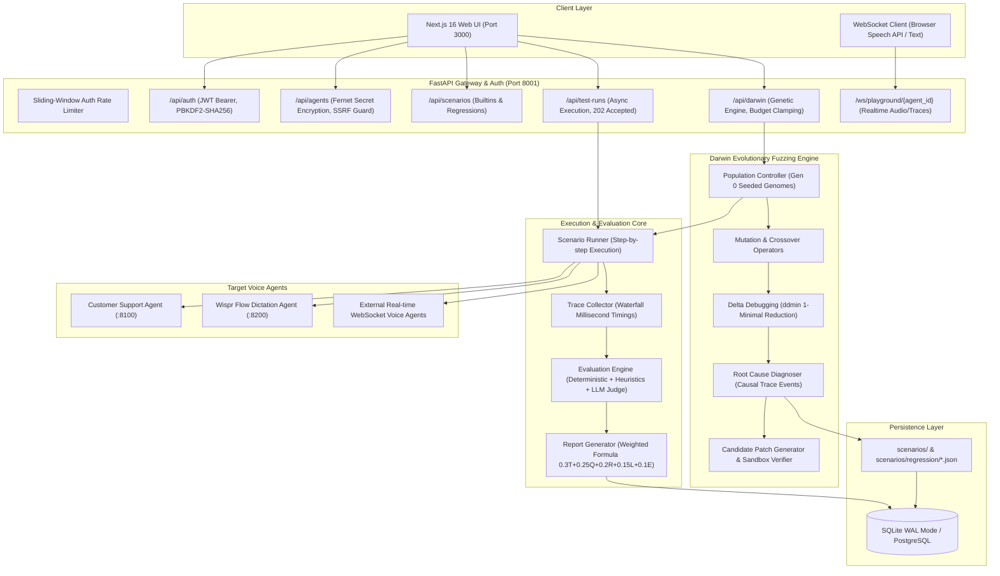

# VoxLab Architecture Audit & System Map

**Platform:** VoxLab (Voice Agent Reliability, Tracing, and Evolutionary Fuzzing)  
**Version:** 0.1.0  
**Audit Date:** November 2026  
**Auditor Roles:** Principal Software Architect, AI Infrastructure Engineer, SRE  

---

## 1. System Architecture Map



---

## 2. Layer-by-Layer Architecture Inspection

### 2.1 Frontend Architecture (`frontend/src/`)
* **Framework:** Next.js 16 (App Router) with React 19 and Tailwind CSS.
* **Routing Structure:**
  - Route Group `(app)` containing authenticated layouts: `/dashboard`, `/agents`, `/agents/new`, `/darwin`, `/darwin/[id]`, `/playground`, `/reports/[id]`, `/runs`, `/runs/[id]`, `/scenarios`, `/traces/[id]`.
  - Auth routes: Unified animated `/register` page with tab switching for login, demo exploration, and registration; `/login` cleanly redirects to `/register`.
* **State & Data Fetching:** Custom `useApi` hook wrapping reactive promises with typed API clients in `lib/api.ts` and React context in `lib/auth-context.tsx`.
* **Visualizations:** Phosphor icons, custom animated waveform CSS, and SVG radar score visualizations (`components/report-view.tsx`).

### 2.2 Backend API & Lifespan (`backend/app/`)
* **Framework:** FastAPI with async routes, structured Pydantic v2 validation models, and async database session dependency injection (`deps.py`).
* **Lifespan Manager:** Startup event asynchronously executes `init_db()` and `load_builtin_scenarios()`, caching scenarios from `scenarios/*.json` into SQLite/Postgres.
* **CORS & Rate Limiting:** Global CORSMiddleware supporting configurable origins and IP sliding-window rate limiting on `/api/auth` (15 requests/minute).

### 2.3 Database Engine & Consistency (`app/core/database.py`)
* **ORM:** SQLAlchemy 2.0 with `aiosqlite` async driver.
* **Concurrency Protection:** SQLite WAL mode (`PRAGMA journal_mode=WAL`), `PRAGMA busy_timeout=60000`, and `PRAGMA synchronous=NORMAL` to prevent database locking during concurrent async tasks.
* **Transaction Safety:** Strict separation of external network I/O from database transactions. Database sessions are flushed or committed in short (<5ms) atomic operations.

### 2.4 Agent Adapters & Protocol Contract
* **HTTP Adapter (`app/adapters/http_adapter.py`):** Speaks the standard JSON contract:
  ```json
  POST /conversation
  {"session_id": "...", "message": "...", "metadata": {"interrupt": false, "inject": {...}}}
  ```
* **WebSocket Adapter (`app/adapters/websocket_adapter.py`):** Real-time bi-directional framing with timeout protection and streaming turn metrics.
* **Credential Protection:** Secrets stored as Fernet-encrypted ciphertext in `agents.auth_config_encrypted`. Decrypted only in-memory at adapter instantiation.

---

## 3. Architectural Strengths & Verified Guardrails
1. **Zero Cloud Lock-in:** The platform works 100% deterministically offline. When no cloud LLM key is configured, transparent heuristic fallbacks score turns and categorize defects with `heuristic: true` surfaced across API and UI.
2. **Hard Budget Enforcement:** Darwin runs enforce a strict cap (`DARWIN_MAX_SESSIONS = 60`) clamped at both API ingestion and loop scheduling to prevent runaway compute or cost.
3. **SSRF Guard:** Agent registration verifies endpoints, blocking internal link-local and cloud metadata addresses (`169.254.169.254`) while validating protocols (`http`, `https`, `ws`, `wss`).

