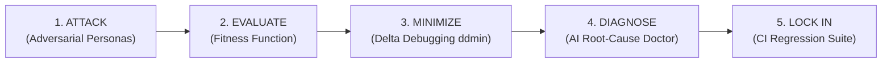

# Darwin Engine — Evolutionary Fuzzing for Voice AI

**Darwin** is VoxLab's core reliability innovation: a multi-generation genetic fuzzer designed specifically for conversational voice agents and speech-to-text dictation pipelines (Wispr Flow).

---

## The 5-Stage Reliability Lifecycle

---

## Detailed Darwin Documentation

- [**Darwin Overview & Architecture**](darwin/DARWIN_OVERVIEW.md)
- [**Evolution Engine & Population Dynamics**](darwin/EVOLUTION_ENGINE.md)
- [**Genome Dataclass & Mutation Operators**](darwin/GENOME_AND_MUTATION.md)
- [**Multi-Dimensional Fitness Scoring**](darwin/FITNESS_EVALUATION.md)
- [**Delta Debugging (`ddmin`) Failure Minimization**](darwin/FAILURE_MINIMIZATION.md)
- [**Root-Cause Diagnosis & Sandbox Patching**](darwin/ROOT_CAUSE_DIAGNOSIS.md)
- [**Automated CI Regression Library**](darwin/REGRESSION_LIBRARY.md)
