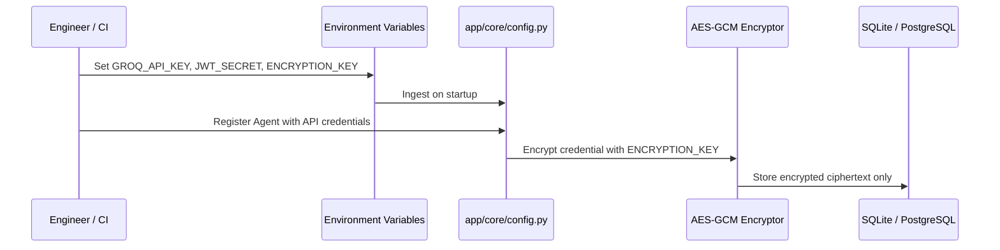

# Secrets & Credential Management Policy

## Principles
1. **Never commit actual secrets:** `.gitignore` excludes `.env`, `*.env`, `backend/.env`, and `frontend/.env.local`.
2. **Deterministic Fallbacks:** The platform functions fully in offline / local development mode without requiring paid API keys.
3. **Environment Injection:** Secrets must always be injected at runtime via process environment variables or container secrets.

## Secrets Lifecycle

